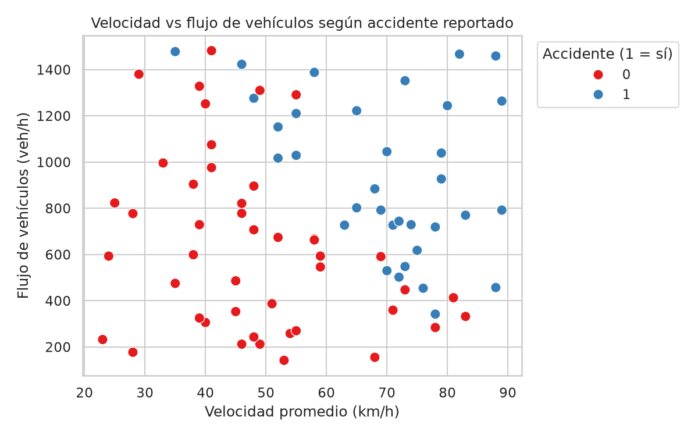
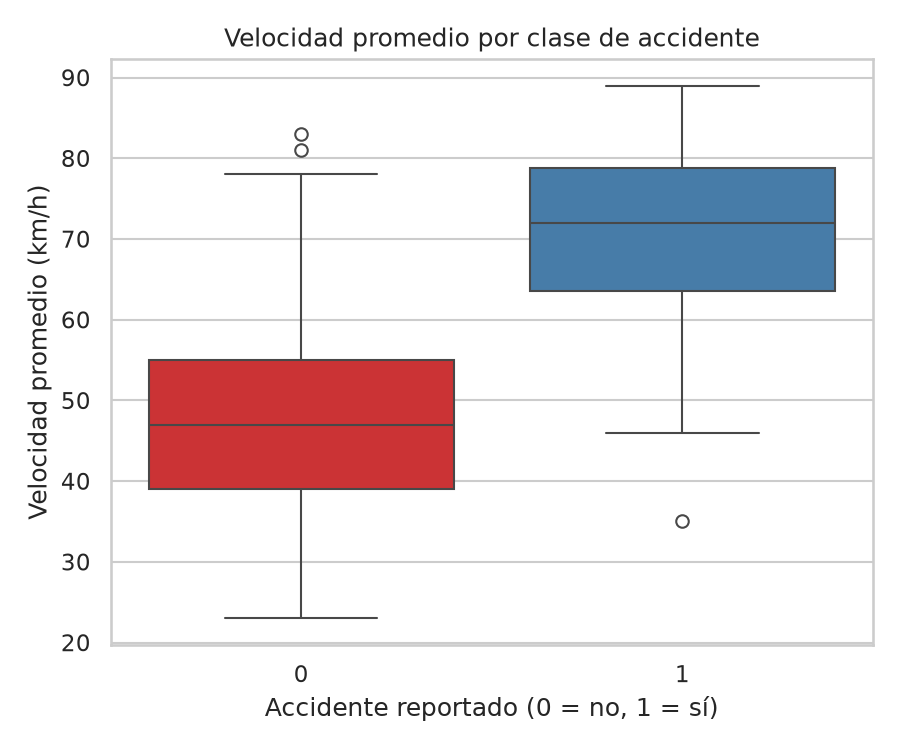
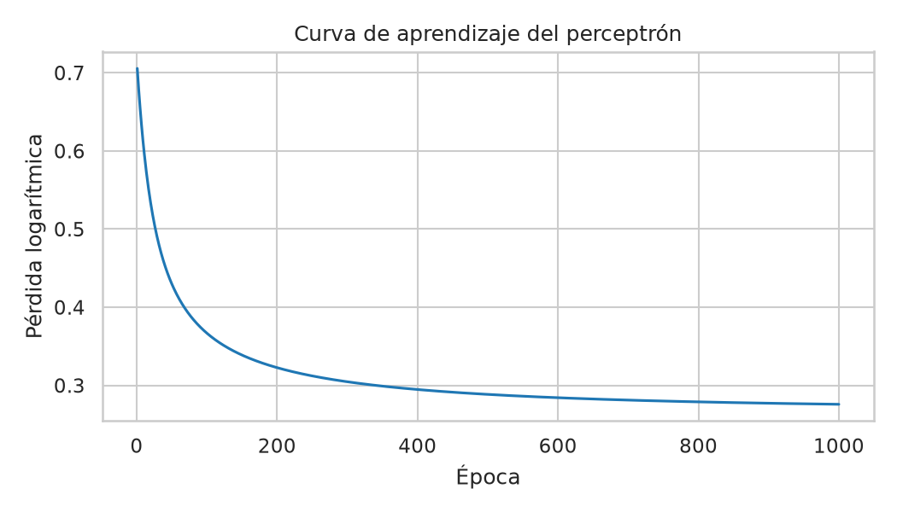
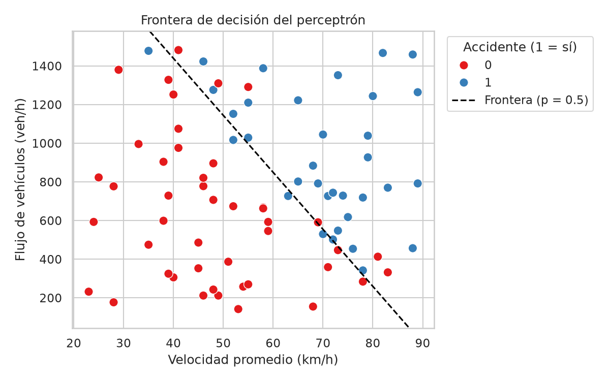

# parcial2-ia-grupo04 – Segundo Parcial de Inteligencia Artificial

**Grupo:** 04
**Integrantes:** Damián Correa Tusarma, Saray Foronda Restrepo
**Archivo de datos:** `grupo_04.csv` (Movilidad – tramos viales de Cartago)
**Entradas:** `velocidad_promedio_kmh`, `flujo_vehiculos_hora` | **Objetivo:** `accidente_reportado` (1 = hubo accidente reportado, 0 = no)

## Estructura del repositorio
```
parcial2-ia-grupo04/
├── Dockerfile
├── docker-compose.yml
├── requirements.txt
├── README.md
├── capturas/                  # evidencias del entorno y de las salidas
├── data/
│   ├── grupo_04.csv           # CSV original
│   ├── grupo_04_limpio.csv    # CSV depurado
│   ├── grafico1_dispersion.png
│   ├── grafico2_boxplot_velocidad.png
│   ├── curva_aprendizaje.png
│   └── frontera_decision.png
└── src/
    └── parcial2.py
```

## Tarea 1: Configuración del entorno
Stack: Python 3.12, NumPy, Pandas, Matplotlib y Seaborn (sin librerías de Machine Learning). Contenedor: `parcial2_ia`.

Reproducir el entorno (WSL + Docker):
```bash
git clone https://github.com/Dami0921/parcial2-ia-grupo04.git
cd parcial2-ia-grupo04
docker stop python_ia            # si el contenedor de las clases está encendido
docker compose up -d --build
docker exec -it parcial2_ia bash

# dentro del contenedor
cd src
python parcial2.py
```
Evidencias en `capturas/` (contenedor en ejecución y versiones de Python y librerías).

## Tarea 2: Carga e inspección
El script `src/parcial2.py` muestra las primeras 5 filas, la forma **(81, 5)**, los tipos de datos, los nulos (zona 1, velocidad 3, accidente 1) y los duplicados (0).

**Pregunta clave: ¿alguna columna numérica aparece con un tipo que no debería tener?**
Sí: `accidente_reportado` aparece como `float64` cuando es una etiqueta binaria que debería ser entera. Ocurre porque la fila `TOTAL` trae un valor vacío (NaN) en esa columna, y Pandas convierte a decimal las columnas con valores faltantes.

## Tarea 3: Calidad y limpieza de datos
| # | Problema | Cómo se detectó | Decisión | Por qué |
|---|---|---|---|---|
| 1 | Fila de resumen `TOTAL` | `tail()` muestra `TOTAL` con zona y objetivo vacíos; `describe()` daba velocidad máx. 4428 | Eliminar | No es un tramo vial; sus sumas distorsionan medias y escalado |
| 2 | Zonas escritas distinto (`NORTE`, `SUR`, `vía panamericana`, `" Sur"`, `"Norte "`, `oriente`) | `value_counts()` mostró 11 etiquetas para 5 zonas | `strip()` y `title()` | Son la misma zona; si no, se contarían como categorías distintas |
| 3 | Flujo de 30456 veh/h en T032 | `describe()` y regla del IQR (límite 1947 veh/h) | Reemplazar por la mediana (729) | Es imposible para un tramo (el resto va de 142 a 1482); probable error de digitación |
| 4 | 3 nulos en velocidad (T011, T071, T080) | `isnull().sum()` | Rellenar con la mediana (55 km/h) | Conserva los tramos; la mediana no la afectan los extremos |
| 5 | Objetivo como `float64` | `dtypes` | Convertir a entero | Es una etiqueta binaria 0/1 |

**Filas antes: 81 | después: 80.** Registros por clase: **0 = 46, 1 = 34**. Resultado guardado en `data/grupo_04_limpio.csv`.

**Pregunta clave: ¿qué valor le pareció más sospechoso?**
El flujo de **30456 veh/h** (tramo T032). La media de `flujo_vehiculos_hora` pasa de **1142.6 a 771.0** al corregirlo, y la desviación estándar de **3341.3 a 387.0**. Sin corregirlo, la estandarización usaría esa media y desviación inflada: los tramos normales (142 a 1482 veh/h) quedarían entre unos −0.3 y +0.1, casi iguales entre sí, y el perceptrón no podría distinguirlos por flujo; T032 quedaría en torno a +8.8 y dominaría el gradiente.

## Tarea 4: Visualización con Seaborn
**Gráfico 1: dispersión de velocidad y flujo, coloreada por accidente** (`data/grafico1_dispersion.png`)



Los tramos con accidente (azul) se concentran a la derecha (velocidades de 60 a 90 km/h), y los tramos sin accidente (rojo) a la izquierda y abajo (23 a 55 km/h, con flujo bajo o medio). Hay mezcla en la zona central y en la esquina superior izquierda. **Conclusión:** la velocidad separa mejor las clases que el flujo, aunque el flujo ayuda: con velocidades parecidas, los tramos con más vehículos tienden a tener accidente. Los datos no son perfectamente separables, pero una recta puede dividirlos bastante bien.

**Gráfico 2: boxplot de la velocidad por clase** (`data/grafico2_boxplot_velocidad.png`)



La mediana de velocidad es **47 km/h en los tramos sin accidente y 72 km/h en los tramos con accidente** (medias 48.3 y 69.7 km/h), y las cajas casi no se solapan. **Conclusión:** los tramos con accidente reportado tienen velocidades promedio claramente más altas. Los pocos atípicos (83 y 81 km/h sin accidente; 35 km/h con accidente) son tramos que no siguen el patrón. El flujo medio también difiere: 642 veh/h (clase 0) frente a 945 veh/h (clase 1).

## Tarea 5: Perceptrón desde cero con NumPy
Implementado solo con NumPy (sin Scikit-Learn): estandarización con media y desviación por columna (se guardan para escalar datos nuevos), `sigmoide`, probabilidad `sigmoide(X @ w + b)`, pérdida logarítmica y exactitud. Entrenamiento con descenso del gradiente: **1000 épocas**, tasa de aprendizaje **0.1**, pesos iniciales aleatorios pequeños (semilla 42), registrando pérdida y exactitud en cada época.

| Dato | Valor |
|---|---|
| Media (velocidad, flujo) | 57.41 y 771.00 |
| Desviación (velocidad, flujo) | 17.56 y 384.57 |
| Pesos iniciales | w1 = 0.0305, w2 = −0.1040, b = 0.0000 |
| Pesos finales | w1 = 3.1750, w2 = 2.3584, b = −0.9477 |
| Pérdida inicial → final | 0.7055 → 0.2758 |
| Exactitud inicial → final | 0.4250 → 0.8625 |

(La desviación se calcula con NumPy, que divide entre n; por eso difiere de los 387.0 de Pandas, que divide entre n−1.)

**Curva de aprendizaje** (`data/curva_aprendizaje.png`): la pérdida baja de forma suave desde 0.7055 y se estabiliza cerca de 0.28.



**Frontera de decisión** (`data/frontera_decision.png`), en las unidades originales: la línea punteada deja a la derecha los tramos con accidente y a la izquierda los demás.



## Tarea 6: Interpretación de resultados
**1. Signo de w1 y w2.** Ambos son positivos: **w1 = 3.175** (velocidad) y **w2 = 2.358** (flujo). A mayor velocidad promedio y a mayor flujo vehicular, sube la probabilidad de accidente reportado. Tiene sentido para Cartago: los tramos rápidos dejan menos margen de reacción y los de más flujo tienen más puntos de conflicto. La velocidad pesa más: subir una desviación (17.6 km/h) multiplica las probabilidades de accidente por unos **24** (e^3.175), y subir una desviación de flujo (385 veh/h), por unos **11** (e^2.358).

**2. Separabilidad.** Los datos son **aproximadamente linealmente separables**: la frontera clasifica bien 69 de 80 tramos (**86.25 %**), pero **11 registros quedan del lado equivocado** (7 falsos positivos y 4 falsos negativos): T003, T011, T023, T029, T031, T034, T036, T044, T048, T051 y T079. Los errores están cerca de la línea (probabilidades entre 0.34 y 0.86); por ejemplo, T003 (35 km/h y 1478 veh/h, con accidente) quedó con probabilidad 0.34.

**3. Dos registros nuevos** (escalados con la media y la desviación del entrenamiento):
- **Esperado 1:** 85 km/h y 1200 veh/h → z = (1.57, 1.12) → probabilidad **0.9987**. Coincide con lo esperado.
- **Esperado 0:** 35 km/h y 300 veh/h → z = (−1.28, −1.22) → probabilidad **0.0004**. Coincide con lo esperado.

Son casos claros en los extremos; el modelo duda más en la zona intermedia, donde están sus errores.

**4. Recomendación a la entidad local.** Priorizar el control de **velocidad** en los tramos que superan unos **63 km/h con flujo medio (771 veh/h)**, donde la probabilidad de accidente cruza 0.5 (con flujo alto, de 1200 veh/h, basta superar unos 48 km/h), por ejemplo con reductores, cámaras o señalización. Se justifica con dos números: la velocidad mediana es **72 km/h en los tramos con accidente frente a 47 km/h** en los demás, y el peso de la velocidad (**3.175**) es mayor que el del flujo (**2.358**).

**5. Limitaciones.**
- Son solo **80 registros** y la exactitud se mide sobre los mismos datos de entrenamiento, así que se sobrestima.
- Solo usa dos variables: ignora iluminación, estado de la vía, clima, hora del día y zona.
- Hay datos corregidos por imputación (3 velocidades y 1 flujo); T011, mal clasificado con probabilidad 0.86, es uno de ellos.
- Muestra correlación, no causalidad: una velocidad media puede esconder picos.
- Una frontera lineal no capta efectos no lineales, y el umbral 0.5 trata igual un falso positivo y un falso negativo.

## Evidencias
Capturas en `capturas/`: contenedor `parcial2_ia` en ejecución, versiones de Python y librerías, salida de la inspección y la limpieza, entrenamiento del perceptrón, y errores de clasificación con los dos registros nuevos.

## Notas
Se utilizó asistencia de IA (Claude), permitida por el enunciado, para apoyar la construcción y la revisión del código; los resultados y las interpretaciones se verificaron ejecutando el script con los datos del grupo.